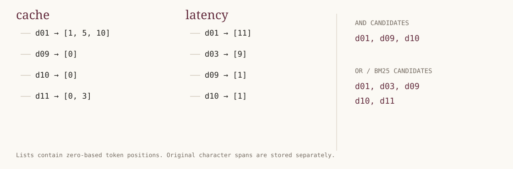

# Positional search index lab

**[View the report in your browser](https://Michaelhoang8.github.io/positional-search-index-lab/)**

A source-built positional inverted index with **exact term, AND, OR and phrase queries**, plus **BM25 ranking with per-term explanations**. Every hit retains token positions and half-open character spans in the original text, including Unicode normalization expansions and overlapping phrases.

The entire implementation, study and HTML/SVG report builder use the Python standard library. Documents and queries are owned synthetic fixtures. Code and documentation were created with AI assistance. There are no human relevance labels, external corpus, web crawler or search-quality claims.

[Recorded result explorer](docs/report.html) · [Original corpus](results/published/corpus.json) · [Index JSON](results/published/index.json) · [Query results and explanations](results/published/results.json)

[Report screenshots](docs/screenshots/README.md) · [Recorded browser review](docs/recordings/README.md)



## What is implemented

- Explicit Unicode tokenization and NFC → case-fold → NFC normalization, with original code-point spans preserved before normalization.
- Read-only nested posting maps containing sorted document IDs and zero-based token positions; exported snapshots are detached from the live index.
- Boolean document-set operations and exact adjacent-position phrase matches, including repeated terms and overlaps.
- A declared positive-IDF BM25 variant with exact document lengths, unique query terms and deterministic document-ID tie ordering.
- Bounded corpus/query input, duplicate JSON key/ID rejection and a CLI that exclusively creates output files.
- A report explorer that renders saved Python results and highlights original text using code-point arrays in the browser.

## Preserved study

The corpus contains 12 documents, 152 token occurrences and 97 distinct normalized terms. Fifteen predetermined queries cover exact matching, AND/OR, punctuation, overlapping phrases, Unicode composition/case folding, empty queries, absent phrases and repeated ranking terms.

For `cache latency`, BM25 orders documents `d09, d10, d01, d11, d03`. The first two documents contain identical text and have exactly equal scores; IDs break the tie. The phrase `echo echo` has two overlapping occurrences in `echo echo echo`, retained separately while display highlighting merges their overlap.

The study preserves 112 actual warmed calls: seven builds and seven queries per case. The original corpus JSON is 1,860 bytes; the index JSON is 26,708 bytes, including original text, token spans and postings. Those are serialized artifact sizes, not compressed-index sizes or resident memory measurements.

A separate bounded workload contains **256 seeded documents, 84,484 original code points and 13,791 tokens**. Ten fixed queries compare the index with an independently implemented document scanner. All document order, positions and original spans reconcile; BM25 scores agree within 1e-12 relative and absolute tolerance. The 147 recorded calls include seven builds and seven repetitions per method/query. [Comparison and observed ranges](results/scale/summary.csv) · [Independent matched evidence](results/scale/results.json)

The scan baseline re-tokenizes the entire corpus for each query. The indexed path reuses postings and additionally constructs highlights and ranking explanations. Construction is timed separately. This deliberately narrow, asymmetric comparison is not an optimized-engine benchmark or universal speedup claim.

## Run

The core supports Python 3.11 or newer. Use **Python 3.13** to reproduce the recorded Unicode 15.1.0 environment and exact artifact checks; the published execution used Python 3.13.17.

```sh
python -m pip install -e .
python -m unittest discover -s tests -v
python -m searchlab build results/published/corpus.json --output index-copy.json
python -m searchlab query results/published/corpus.json --mode phrase --query "echo echo"
python -m searchlab query results/published/corpus.json --mode bm25 --query "cache latency"
```

The CLI reads the original corpus and builds the in-memory index on each invocation. `build` exports an inspectable snapshot; loading a saved snapshot as a persistent search database is outside scope. `query` emits positions, original spans, merged highlights, candidate IDs and score explanations. Existing output files are never overwritten.

## Reproduce

```sh
python scripts/run_study.py --out outputs/reproduction
python scripts/run_scale.py --out outputs/scale-reproduction
python scripts/verify_reproduction.py outputs/reproduction results/published
python scripts/verify_reproduction.py outputs/scale-reproduction results/scale
python scripts/build_report.py
python -m http.server 8000
```

Open `http://localhost:8000/docs/report.html`. New studies require an empty directory. The report builder reads `results/published` and `results/scale` and collects no new measurements. Captured browser media, when added, are actual automated reviews of that report.

CI runs independent scan/BM25 oracles and evidence checks, then builds separate fresh inspection and scale experiments. Deterministic corpus, index, postings and query results are reconciled with the stored run; current timings remain separate. Tests include 3,000 independent Boolean/phrase comparisons, 100 separately scored BM25 corpora, exact Unicode spans, overlap/tie behavior, input limits, CLI exclusivity and source/artifact hashes.

## Optional browser verification

```sh
python -m pip install -r requirements-browser.txt
python -m playwright install chromium
python scripts/check_report_browser.py
```

Use `--channel msedge` for an installed Edge browser. The optional check visits all fifteen saved queries at 390 and 1440 pixels, compares every displayed original string and highlight with the stored Python spans, exercises keyboard details and horizontal table scrolling, and checks local links, images and page overflow. It writes review screenshots and results under ignored `outputs/browser-review`; it never remeasures the search study. Browser tooling is outside measurement-source provenance.

## Evidence map

| Path | Evidence |
|---|---|
| `src/searchlab/core.py` | Tokenizer, positional postings, queries, BM25 and highlights |
| `src/searchlab/io.py` | Bounded corpus JSON loading |
| `results/published/corpus.json` | Original document strings and display titles |
| `results/published/index.json` | Full token offsets, positions, postings and corpus statistics |
| `results/published/postings.csv` | One row per term occurrence with original spans |
| `results/published/results.json` | Complete query candidates, hits, explanations and overlaps |
| `results/published/measurements.csv` | 112 actual build/query durations |
| `results/scale/` | 256-document corpus, full index, both methods’ matches, 147 timings and hashes |
| `scripts/scan_reference.py` | Independent ASCII document-scan and rearranged BM25 oracle |
| `docs/tokenization.md` | Exact normalization and span rules |
| `docs/ranking.md` | Formula, tie behavior and primary references |
| `docs/methodology.md` | Measurements, provenance and bounds |

This is a bounded lexical index, not a general search service. It has no stemming, stopword removal, fuzzy matching, linguistic segmentation, incremental updates, concurrent mutation support or retrieval-quality evaluation. BM25 scores are not relevance probabilities.
